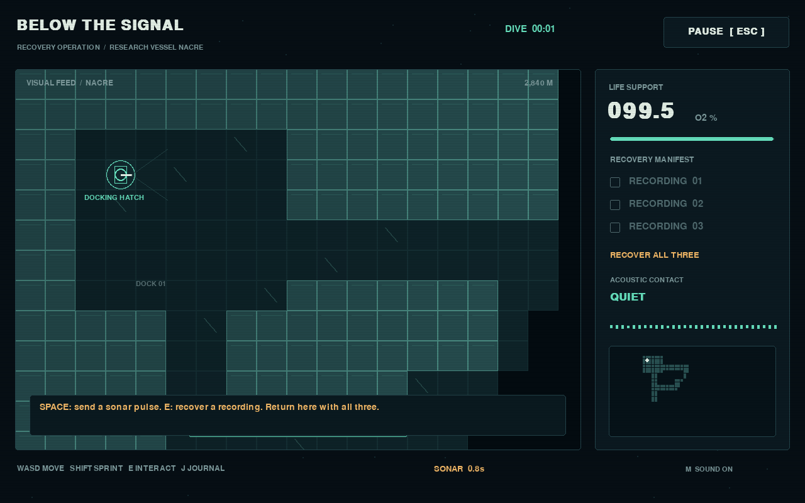

# BELOW THE SIGNAL

A compact sonar horror game built in Python. Recover three black-box recordings from a wreck, then find your way back to the docking hatch. Your sonar reveals the dark—and tells something in the water where you are.

The research vessel Nacre has been silent for 19 days. Three black-box recordings remain below. You have one assignment: bring them home. Whatever happened here is not finished.



## The dive

Search the wreck, locate all three recordings, and return to the docking hatch to escape. Use sonar to understand the space around you, but listen and watch for the creature's response. Sprinting helps you cross dangerous ground and makes more noise. Watch your oxygen reserve and recover emergency air cylinders along the way.

The environment, effects, and audio are generated procedurally. The interface uses pygame-ce's bundled font. No separate asset downloads or paid services are required.

## Play

For a packaged Windows release, extract the entire ZIP and launch `BelowTheSignal.exe`. Keep the extracted files together.

[Download the Windows game](https://github.com/4onv/below-the-signal/releases/latest) — no Python installation required. Choose `BelowTheSignal-v1.0.0-Windows-x64.zip` under Assets.

To run from source, install Python 3.11 or newer, open a terminal in this folder, and run:

```powershell
python -m pip install -r requirements.txt
python main.py
```

On Windows, use `py` in place of `python` if that is the command available for your Python installation.

| Control | Action |
| --- | --- |
| WASD / arrow keys | Move |
| Shift | Sprint; makes more noise |
| Space | Send a sonar pulse |
| E | Interact / recover a recording or air cylinder / use the docking hatch |
| J | Open or close the recording journal; the dive pauses while reading |
| Esc | Pause or resume |
| M | Mute or unmute sound |
| F11 | Toggle fullscreen |

Sonar and threat feedback include visual cues. A reduced-motion option is available in the menu for players who prefer less screen movement.

## Development

The application is written in Python and uses [pygame-ce](https://pyga.me/). The dependency's compiled internals handle the window, drawing, input, and audio; game code remains Python.

Run the test suite from the project folder:

```powershell
python -m unittest discover -s tests
```

See [release notes](docs/RELEASE_NOTES.md) for the release scope.

Build the Windows download on Windows:

```powershell
python -m pip install -r requirements-build.txt
python tools/build_windows.py
```

The builder creates and smoke-tests a standalone executable, then packages it with instructions and license notices in `dist/`. GitHub Actions also runs the tests on Windows and Linux and produces a Windows artifact.

Settings and completion records are stored in `%LOCALAPPDATA%/BelowTheSignal/progress.json` on Windows. An unfinished dive restarts from the beginning when the application closes.

## License

The source code and authored procedural graphics and audio are available under the [MIT License](LICENSE), copyright 2026 Quinn. Dependencies retain their own licenses; see [third-party notices](docs/THIRD_PARTY_NOTICES.md).
